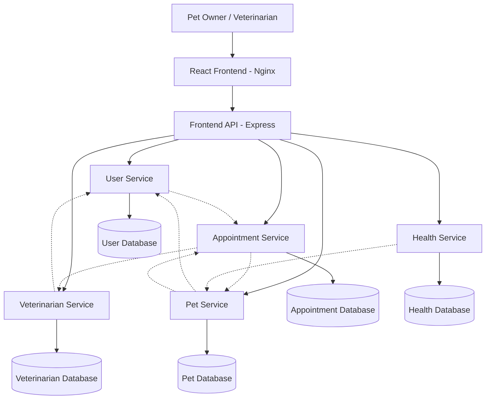
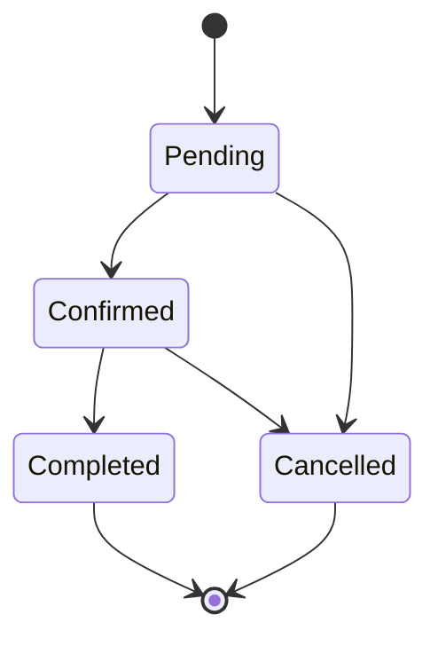

# PetCare

PetCare is a microservices-based web application for pet care management, veterinary appointments and health records. The application connects pet owners and veterinarians and provides a central platform for managing pets, appointments, vaccinations, medications and medical history.

## Features

### Pet Owners

- User registration and authentication.
- Personal profile management.
- Adding, editing and deleting pets.
- Managing pet weight measurements.
- Visual representation of weight history.
- Viewing vaccinations and medications.
- Viewing complete pet health history.
- Searching for veterinarians.
- Viewing veterinarian availability.
- Booking, editing and cancelling appointments.
- Tracking appointment status.
- Viewing appointment notes.

### Veterinarians

- User authentication and profile management.
- Creating and managing a veterinarian profile.
- Managing available appointment slots.
- Viewing assigned appointments.
- Confirming, completing and cancelling appointments.
- Adding and deleting appointment notes.
- Viewing patient information.
- Automatic patient selection based on appointments.
- Managing vaccinations and medications.
- Viewing patient health history and weight measurements.

## Architecture

PetCare uses a microservices architecture. Each backend microservice is responsible for a specific business domain and has its own PostgreSQL database.

The React frontend communicates with the Frontend API, which forwards requests to the appropriate microservice.



## Microservices

| Service | Technology | Responsibility |
|---|---|---|
| User Service | Node.js, Express, Prisma | Authentication, authorization and user management |
| Pet Service | Node.js, Express, Prisma | Pet management and weight measurements |
| Veterinarian Service | ASP.NET Core, Entity Framework Core | Veterinarian profiles and availability |
| Appointment Service | ASP.NET Core, Entity Framework Core | Appointment booking, status management and notes |
| Health Service | Python, FastAPI, SQLAlchemy | Vaccinations, medications and health history |
| Frontend API | Node.js, Express, Axios | API gateway and request forwarding |
| Frontend | React, TypeScript, Vite, Nginx | User interface |

## Technology Stack

### Frontend

- React
- TypeScript
- Vite
- React Router
- Axios
- Lucide React
- Recharts
- CSS
- Nginx

### Backend

- Node.js
- Express.js
- Prisma ORM
- ASP.NET Core
- Entity Framework Core
- Python
- FastAPI
- SQLAlchemy
- Pydantic
- HTTPX

### Database and Infrastructure

- PostgreSQL
- Docker
- Docker Compose
- Docker networking
- Persistent Docker volumes
- REST APIs
- JSON Web Tokens (JWT)
- OpenAPI
- Git and GitHub

## Project Structure

```text
PetCare/
├── appointment-service/
├── veterinarian-service/
├── user-service/
├── pet-service/
├── health-service/
├── frontend-api/
├── frontend/
├── docs/
├── .gitignore
├── README.md
├── start.ps1
└── stop.ps1
```

Each service contains its own implementation, dependencies, configuration and Docker Compose file.

## Docker Infrastructure

The complete application consists of 12 Docker containers.

| Container | Host Port |
|---|---:|
| petcare-frontend | 5173 |
| petcare-frontend-api | 8000 |
| petcare-user-service | 8001 |
| petcare-pet-service | 8002 |
| petcare-veterinarian-service | 8003 |
| petcare-appointment-service | 8004 |
| petcare-health-service | 8005 |
| petcare-user-db | 5433 |
| petcare-pet-db | 5434 |
| petcare-health-db | 5435 |
| petcare-veterinarian-db | 5436 |
| petcare-appointment-db | 5437 |

All backend services communicate through the shared Docker network named `petcare-network`.

Each database uses a separate service-specific network and a persistent Docker volume. Database information is preserved when containers are stopped or restarted.

The frontend uses a multi-stage Docker build. The React application is built using Node.js and served using Nginx.

Nginx also acts as a reverse proxy and forwards `/api` requests to the Frontend API.

## Getting Started

### Prerequisites

- Git
- Docker Desktop
- Docker Compose
- PowerShell

For local development without Docker:

- Node.js 24
- npm
- Python and .NET SDK versions compatible with the respective services

### 1. Clone the Repository

```bash
git clone https://github.com/matejadju/PetCare.git
cd PetCare
```

### 2. Configure Environment Variables

Each application component contains an `.env.example` file.

Create local environment files using PowerShell:

```powershell
$services = @(
    "user-service",
    "pet-service",
    "veterinarian-service",
    "appointment-service",
    "health-service",
    "frontend-api",
    "frontend"
)

foreach ($service in $services) {
    if (-not (Test-Path "$service/.env")) {
        Copy-Item "$service/.env.example" "$service/.env"
    }
}
```

Update the environment files with appropriate configuration values.

Important configuration requirements:

- Configure database passwords for each microservice.
- Use the same JWT secret across all backend services that validate tokens.
- Use consistent JWT issuer and audience values.
- Keep environment files private.
- Do not commit passwords, tokens or other sensitive information.

The `.env` files are excluded from Git. The `.env.example` files provide configuration templates.

### 3. Start the Application

Make sure Docker Desktop is running.

From the root directory, execute:

```powershell
.\start.ps1
```

The startup script:

- Checks Docker availability.
- Validates Docker Compose configurations.
- Checks required environment files.
- Creates the shared Docker network if necessary.
- Creates the required external health database volume if necessary.
- Builds Docker images.
- Starts all application containers.
- Waits for configured container healthchecks.

If PowerShell prevents script execution, allow execution for the current session:

```powershell
Set-ExecutionPolicy -Scope Process -ExecutionPolicy Bypass
```

Then execute the startup script again.

### 4. Access the Application

Open the following address in a web browser:

```text
http://localhost:5173
```

Frontend API:

```text
http://localhost:8000
```

### 5. Stop the Application

```powershell
.\stop.ps1
```

The script stops all application containers without deleting database volumes.

Do not use `docker compose down -v` unless permanent deletion of the associated database volumes is intended.

## Local Development

The frontend and Frontend API can also run outside Docker while the backend microservices remain containerized.

Stop the corresponding Docker frontend containers before starting local development servers to avoid port conflicts.

### Frontend API

```powershell
cd frontend-api
npm ci
npm run dev
```

The Frontend API runs on:

```text
http://localhost:8000
```

Example local configuration:

```dotenv
PORT=8000
NODE_ENV=development
FRONTEND_URL=http://localhost:5173
USER_SERVICE_URL=http://localhost:8001
PET_SERVICE_URL=http://localhost:8002
VETERINARIAN_SERVICE_URL=http://localhost:8003
APPOINTMENT_SERVICE_URL=http://localhost:8004
HEALTH_SERVICE_URL=http://localhost:8005
```

### React Frontend

```powershell
cd frontend
npm ci
npm run dev
```

Example local configuration:

```dotenv
VITE_API_URL=http://localhost:8000/api
```

The frontend runs on:

```text
http://localhost:5173
```

The Docker version uses the relative `/api` URL through the Nginx reverse proxy.

## API Overview

All frontend API requests use the `/api` prefix.

| Endpoint | Description |
|---|---|
| `/api/users` | User management |
| `/api/users/register` | User registration |
| `/api/users/login` | User authentication |
| `/api/users/me` | Current user information |
| `/api/pets` | Pet management |
| `/api/pets/{id}` | Individual pet information |
| `/api/pets/{id}/weights` | Pet weight measurements |
| `/api/veterinarians` | Veterinarian management |
| `/api/veterinarians/{id}/availability` | Veterinarian availability |
| `/api/appointments` | Appointment management |
| `/api/appointments/{id}/status` | Appointment status management |
| `/api/appointments/{id}/notes` | Appointment notes |
| `/api/vaccinations` | Vaccination records |
| `/api/medications` | Medication records |
| `/api/health-history/{petId}` | Pet health history |

Individual microservices are responsible for business logic, input validation, database operations and authorization.

The Frontend API forwards HTTP requests, authorization headers and responses between the frontend and backend microservices.

## Appointment Management

Pet owners can book appointments by selecting a pet, veterinarian and available appointment slot.

Appointments support four statuses:

- Pending
- Confirmed
- Completed
- Cancelled



New appointments are created with the pending status.

Veterinarians can confirm or complete appointments. Pet owners can edit active appointments or cancel them. Editing an active appointment resets its status to pending.

The Appointment Service validates selected appointment slots and prevents duplicate active reservations for the same slot.

Appointment dates and times are displayed in the Europe/Ljubljana time zone.

## Health Records

The Health Service manages:

- Vaccination records.
- Medication records.
- Combined pet health history.

Pet owners can view health records for their own pets.

Veterinarians can create health records and update or delete records they created.

The Health Service communicates with the Pet Service to validate pet existence and access permissions.

## Authentication and Security

PetCare uses JWT-based authentication and role-based authorization.

Supported roles:

- OWNER
- VETERINARIAN

Implemented security mechanisms include:

- Password hashing.
- JWT validation.
- Protected frontend routes.
- Role-based endpoint authorization.
- Resource ownership validation.
- Input validation.
- Authorization header forwarding.
- Environment-based configuration.
- Separate databases for individual microservices.
- Database ports restricted to the local machine.

Authentication tokens are included in API requests using the Authorization header:

```text
Authorization: Bearer <token>
```

## Frontend Optimization

The React frontend uses route-based lazy loading with `React.lazy()` and `Suspense`.

Individual pages are loaded when required instead of loading the entire application during startup.

The weight history chart library is loaded as part of the Pet Details page.

During development, the main JavaScript bundle was reduced from approximately 796.83 kB in an earlier build to 332.14 kB after optimization.

This represents an approximately 58.3% reduction in the main bundle size.

## Testing

The following functionality was tested during development:

- User authentication and registration.
- User profile management.
- Pet CRUD operations.
- Weight measurement management.
- Vaccination and medication CRUD operations.
- Health history retrieval.
- Veterinarian profile management.
- Availability management.
- Appointment booking and status changes.
- Appointment notes.
- Role-based access restrictions.
- Resource ownership restrictions.
- Communication between microservices.
- Docker network connectivity.
- Nginx reverse proxy integration.
- Persistent database storage.
- Central startup and shutdown scripts.

### Frontend Validation

```powershell
cd frontend
npm run build
npm run lint
npm audit
```

### Frontend API Dependency Validation

```powershell
cd frontend-api
npm audit
```

At the time of development testing, npm audit reported zero known vulnerabilities for both frontend projects.

### Docker Status

```powershell
docker ps --filter "name=petcare-"
```

### Health Checks

```powershell
Invoke-RestMethod http://localhost:5173/health
Invoke-RestMethod http://localhost:8000/health
Invoke-RestMethod http://localhost:8005/
```

Docker healthchecks are configured for the databases, User Service, Pet Service, Health Service, Frontend API and frontend.

## Known Limitations and Future Improvements

- Restrict veterinarian access to patient records at the backend level based on assigned appointments.
- Prevent modification or deletion of availability slots associated with active appointments.
- Improve availability responses to identify already reserved slots.
- Add dedicated healthchecks to the Veterinarian and Appointment services.
- Improve authentication token storage for production environments.
- Configure HTTPS and restrict direct backend service exposure in production.
- Extend automated unit and integration testing.
- Implement appointment reminders and notifications.
- Configure automated CI/CD pipelines.

## Team Responsibilities

| Team Member | Responsibilities |
|---|---|
| Mateja | User Service and Pet Service |
| Valentina | Veterinarian Service and Appointment Service |
| Teodora | Health Service, Frontend API and React frontend |

## Conclusion

PetCare demonstrates the implementation of a distributed application using microservices, REST APIs, independent databases, role-based authorization and containerized infrastructure.

The application provides an integrated environment for pet owners and veterinarians to manage pets, veterinary appointments and health records.
